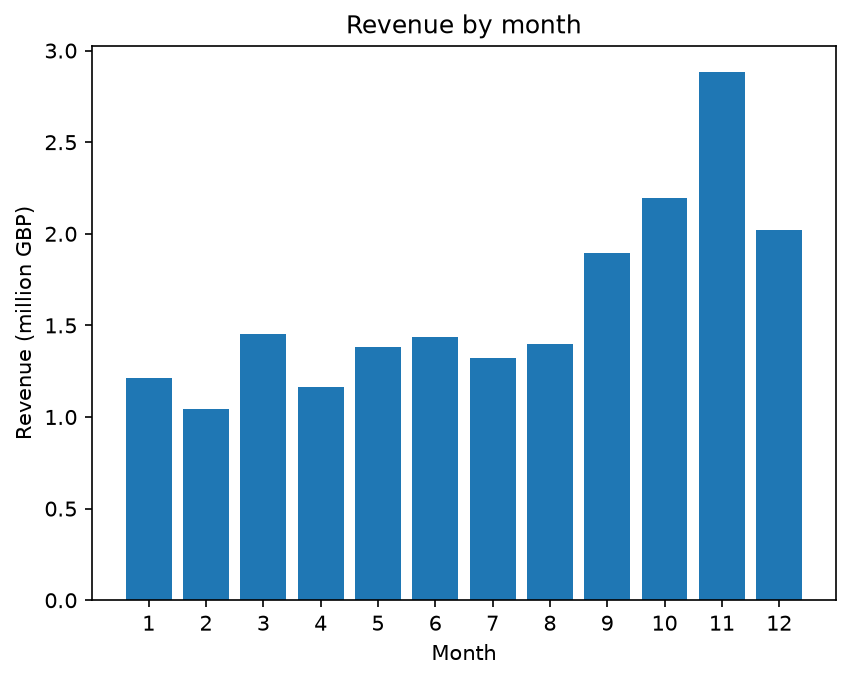
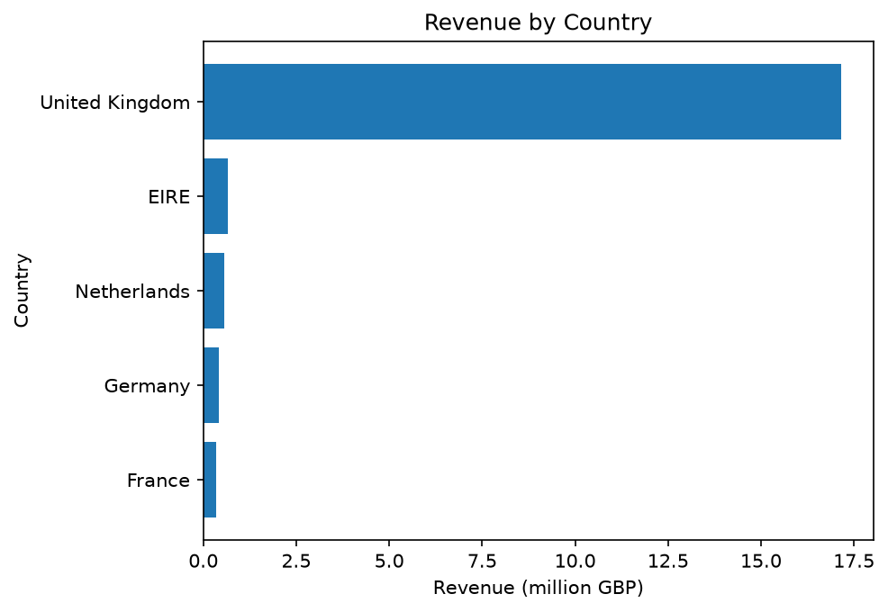
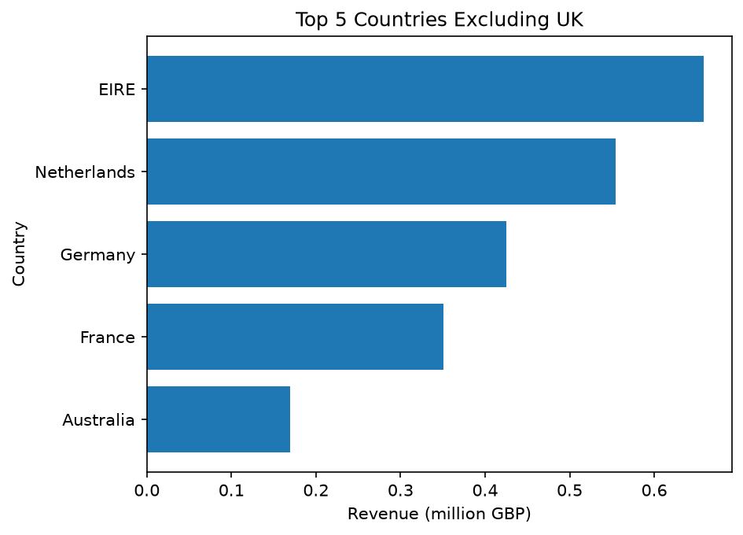
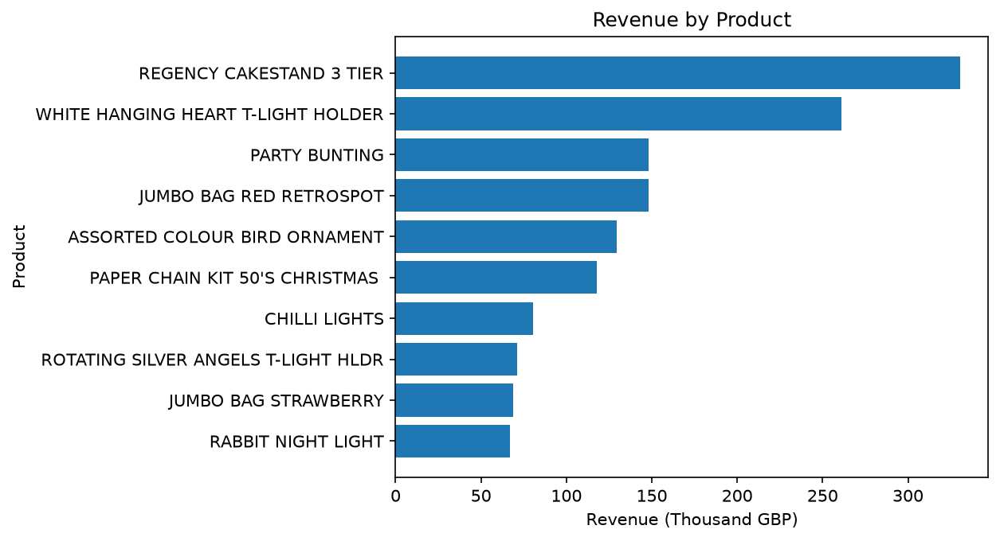
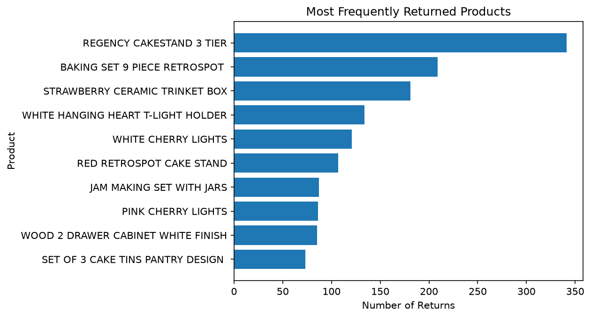
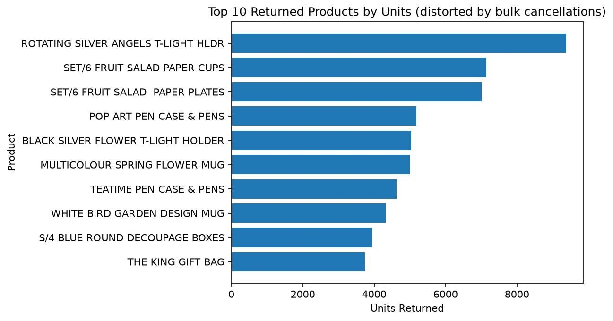

# E-commerce Sales Analysis

Cleaning and analyzing messy online retail data with Python (pandas and matplotlib) to find where the money comes from, when it comes, and what gets returned.

## Business questions

1. Which countries earn the most?
2. Which months sell best?
3. Which products earn the most?
4. How many customers and orders are there?
5. Which products are returned most, and how often do customers return things?

## Dataset

Online Retail II (UCI Machine Learning Repository, also on Kaggle). It holds real transactions from a UK-based online shop.

- Period: 1 December 2009 to 9 December 2011
- Size before cleaning: 1,067,371 rows and 8 columns
- Columns: Invoice, StockCode, Description, Quantity, InvoiceDate, Price, Customer ID, Country
- The data files are not in this repo because of their size. Download the dataset from Kaggle and put it in a folder named `data/`.

## Data cleaning

The raw data had duplicates, cancelled orders, fake and fee rows, and missing values. Every change is listed here, with the rows left after each step.

| Problem found | What I did | Rows left |
|---|---|---|
| 34,335 duplicate rows | Removed them | 1,033,036 |
| InvoiceDate stored as text | Converted to real dates | 1,033,036 |
| Cancelled orders (invoice starts with "C"), 19,104 rows | Moved to a separate returns table | 1,013,932 |
| Rows with a price of zero or less, 6,019 rows | Removed them | 1,007,913 |
| Two huge sales (80,995 and 74,215 units) that were cancelled minutes later, worth about 245,000 GBP | Removed the two sales | 1,007,911 |
| Non-product rows: postage, manual entries, carriage, discounts, samples, bad debt adjustments (4,393 rows) | Moved to a separate table | 1,003,518 |
| Bank charges, Amazon fees and gift vouchers (114 rows) | Moved to the same table | 1,003,404 |

I also added a Revenue column (Quantity x Price). In the returns table, I removed the two bulk cancellations and moved 1,138 fee rows into their own file, leaving 17,964 genuine return lines.

Missing values: about 243,000 rows (23%) had no Customer ID. I kept them because they are real sales and are valid for country, product and month analysis. They cannot be used for customer-level questions.

## Key findings

Total product revenue is about 19.4 million GBP.

1. **The business is mostly UK-based.** The UK earned about 16.6 million GBP, around 85% of all revenue and roughly 26 times more than the next country, Ireland (EIRE).
2. **Top international markets:** EIRE about 0.63M GBP, Netherlands 0.55M, Germany 0.38M and France 0.31M.
3. **Sales are seasonal.** Revenue climbs from September and peaks in November at about 2.88M GBP. February is the weakest month at about 1.05M GBP. October to December together bring in about 37% of all revenue.
4. **Top products by revenue:** the Regency Cakestand 3 Tier (about 330K GBP) and the White Hanging Heart T-Light Holder (about 260K GBP) lead, followed by Party Bunting, Jumbo Bag Red Retrospot and Assorted Colour Bird Ornament at 129K to 148K each.
5. **Customers and orders:** 5,861 identified customers and 39,563 invoices. The invoice count includes orders with no Customer ID, so the two numbers should not be divided to get orders per customer.
6. **Returns are low.** About 2.8% of units sold were returned. By number of return lines, the Regency Cakestand is returned most often (341 times), followed by the Baking Set 9 Piece Retrospot (209) and the Strawberry Ceramic Trinket Box (181).

## Charts



Revenue rises from September and peaks in November.



The UK dominates revenue.



Without the UK, EIRE, the Netherlands, Germany and France lead.



The Regency Cakestand and the White Hanging Heart holder are the top earners.



Counting return lines gives the most reliable picture of what gets returned.

## A trap worth noting

My first returns chart ranked products by units returned, and it put "Rotating Silver Angels T-Light Holder" and the Fruit Salad paper cups and plates at the top. Checking the rows showed that each was a single huge cancellation (for example, 9,360 holders at 3 pence each, and 7,000+ cups and plates from one French customer in one minute). I kept that chart as `top_returns_units.png` as a warning, and used the number of return lines instead.



## Limitations

- Revenue is before returns. Cancelled orders are in a separate table, but the original sales of most of them are still counted, except the two huge ones I removed.
- Monthly totals combine all years. December appears in three years (the last one only to 9 December), and the other months in two, so months show a general pattern and not exact yearly figures.
- Customer-level results ignore the 23% of rows with no Customer ID.
- Popular products are returned more often simply because more are sold. This analysis does not calculate a return rate per product.

## Project structure

```
ecommerce-sales-analysis-1/
  data/          raw and cleaned files (not uploaded)
  images/        charts used in this README
  notebooks/
    01_cleaning.ipynb    cleaning and splitting the data
    02_analysis.ipynb    analysis and charts
  README.md
```

## How to run

1. Download Online Retail II from Kaggle and save it in `data/`.
2. Install the tools: `pip install pandas matplotlib openpyxl jupyter ipykernel`
3. Run `01_cleaning.ipynb` from top to bottom. It saves clean_sales.csv, returns.csv, non_products.csv and returns_fees.csv in `data/`.
4. Run `02_analysis.ipynb` from top to bottom.

## Tools used

Python, pandas, matplotlib, Jupyter Notebook, Git and GitHub.

## Next steps

- Calculate a return rate per product (returns divided by sales)
- Calculate net revenue after returns
- Repeat the analysis in SQL
- Build a dashboard in Power BI

## Author

Zahin ([GitHub](https://github.com/Zahin826))